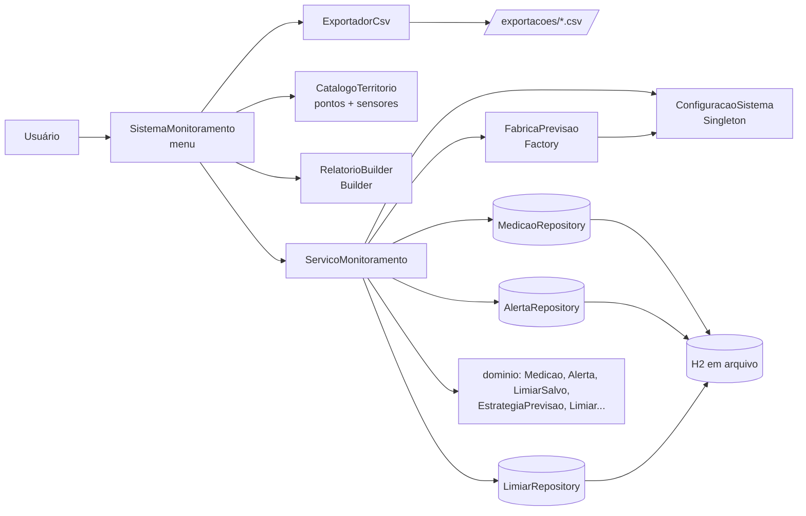
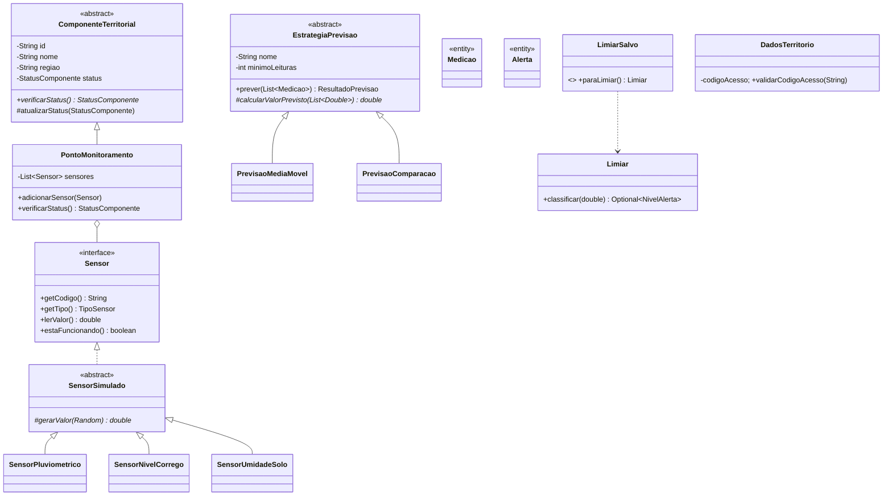
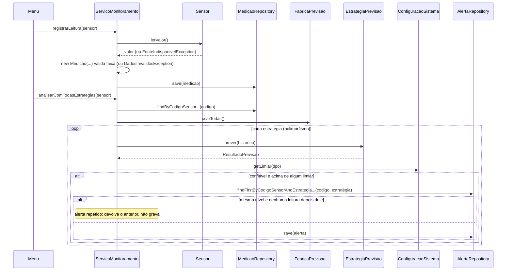

# Arquitetura e explicação do código

## 1. Visão geral

Aplicação **de console** (sem API REST, sem tela gráfica) feita em Spring Boot. O Spring cuida de três coisas:
injetar as dependências, abrir/fechar conexões com o banco e gerar o SQL dos repositories.
O menu roda dentro do Spring como um `CommandLineRunner`.

```
br.com.fiap.territory
├── SistemaMonitoramento.java   → main + menu (Scanner). Só conversa com o usuário.
├── dominio/                    → regras "puras" de POO, sem Spring (exceto anotações JPA)
├── excecao/                    → DadosInvalidosException, FonteIndisponivelException
├── persistencia/               → MedicaoRepository, AlertaRepository, LimiarRepository (Spring Data JPA)
└── servico/                    → ServicoMonitoramento, FabricaPrevisao, ConfiguracaoSistema,
                                  CatalogoTerritorio, BeansConfig, AnalisePrevisao,
                                  RelatorioBuilder, ExportadorCsv
src/test/java/...               → testes JUnit 5 + Mockito (sem console); só RepositoriosJpaTest usa banco (H2 em memória)
src/main/resources/application.properties → H2 em arquivo, código de acesso, pasta do CSV, log silencioso
```

### Camadas e quem chama quem



Regra de ouro: **o menu não tem regra de negócio** e **o serviço não usa `Scanner` nem `System.out`**.
É isso que permite testar o serviço com Mockito.

## 2. Diagrama de classes do domínio



## 3. Classe por classe

### `excecao/`

| Classe | Quando é lançada | Onde é capturada |
|---|---|---|
| `DadosInvalidosException` | medição fora da faixa física, população/domicílios negativos, limiar fora de ordem ou negativo, código de acesso errado, nome vazio, sensor sem medições para exportar, limiar inválido gravado no banco | menu (opções 1, 3 → 3, 4 e ao iniciar) |
| `FonteIndisponivelException` | sensor não respondeu (`SensorSimulado.lerValor`), código de sensor inexistente (`CatalogoTerritorio.buscarSensor`) | menu (opções 1 e 3) |

As duas são **checked** (`extends Exception`): o compilador obriga quem chama a tratar ou declarar `throws`.
Assim nenhum erro some sem ninguém perceber.

### `dominio/`

| Classe | Papel | Conceito de POO |
|---|---|---|
| `ComponenteTerritorial` | Base abstrata de tudo que é monitorado (id, nome, região, status) | **Abstração** + método abstrato `verificarStatus()`. Status só muda por `atualizarStatus()` (protected) |
| `PontoMonitoramento` | Ponto vulnerável com uma lista de sensores. Status = OPERANDO / PARCIAL / INOPERANTE conforme quantos sensores responderam | **Herança** (filha concreta). Lista exposta como `unmodifiableList` |
| `Sensor` | Interface: `lerValor()`, `estaFuncionando()`, `getTipo()`, `getCodigo()` | **Interface / polimorfismo** |
| `SensorSimulado` | Base abstrata dos 3 sensores: sorteia falha de comunicação (5%) e leitura corrompida (3%), delega o valor a `gerarValor()` | Evita duplicar código nos 3 sensores |
| `SensorPluviometrico`, `SensorNivelCorrego`, `SensorUmidadeSolo` | As **3 implementações** de `Sensor`, cada uma com faixa realista. O pluviômetro simula **episódios** de chuva forte que duram algumas leituras (ver RN02) | **Polimorfismo** |
| `TipoSensor` | Enum com descrição, unidade e **faixa física** de cada tipo + `validar(valor)` | Centraliza a validação |
| `DadosTerritorio` | Nome, população, domicílios em risco e o **código de acesso** (sem getter) | **Encapsulamento**: setters validam e lançam exceção |
| `Limiar` | Três cortes (atenção < alerta < crítico), imutável, com `classificar(valor)` | Objeto de valor validado no construtor |
| `NivelAlerta` | ATENCAO, ALERTA, CRITICO + ação recomendada | Enum |
| `Medicao` | **Entidade JPA** (tabela `MEDICAO`). O construtor chama `TipoSensor.validar` | Não existe Medicao inválida |
| `Alerta` | **Entidade JPA** (tabela `ALERTA`) com sensor, nível, valor previsto, limite estourado e estratégia. `explicar()` monta a frase do porquê | |
| `LimiarSalvo` | **Entidade JPA** (tabela `LIMIAR`): limiar alterado pelo menu, chave = tipo de sensor. `paraLimiar()` volta para o objeto de domínio passando de novo pela validação | Separa o que é gravado (entidade) do objeto de valor imutável (`Limiar`) |
| `EstrategiaPrevisao` | Abstrata. `prever()` confere o mínimo de leituras e chama o abstrato `calcularValorPrevisto()` | **Template**: parte comum na mãe |
| `PrevisaoMediaMovel` | Média das últimas N (padrão 5). Sobrescreve `prever()`, chama `super.prever()` e escreve o significado | `super()` no construtor e no método |
| `PrevisaoComparacao` | Compara a média das últimas N com as N anteriores e projeta: `recente + (recente − anterior)`, nunca abaixo de 0 | idem |
| `ResultadoPrevisao` | `record` com valor previsto, se é confiável e o significado em texto | |
| `TipoEstrategia` | Enum MEDIA_MOVEL / COMPARACAO, usado pela fábrica | |

### `persistencia/`

* `MedicaoRepository`: `findByCodigoSensorOrderByDataHoraAscIdAsc` (histórico cronológico) e `countByCodigoSensor`.
* `AlertaRepository`: `findAllByOrderByDataHoraDesc` (alertas mais recentes primeiro) e
  `findFirstByCodigoSensorAndEstrategiaOrderByDataHoraDescIdDesc` (último alerta de um sensor por estratégia, usado
  para não gravar alerta repetido).
* `LimiarRepository`: só os métodos herdados do `JpaRepository` (`save`, `findAll`, `deleteAll`). Como a chave é o
  tipo de sensor, gravar de novo o mesmo tipo **substitui** a linha anterior.

O Spring Data gera o SQL **com parâmetros** a partir do nome do método, então não há concatenação de String.
Conexões e transações são abertas e fechadas pelo Spring.

### `servico/`

| Classe | Papel |
|---|---|
| `ServicoMonitoramento` (`@Service`) | Coração da regra de negócio: `registrarLeitura`, `buscarHistoricoPorSensor`, `analisar`, `analisarComTodasEstrategias`, `avaliarAlerta`, `listarAlertas`, `alterarLimiar` (aplica e grava), `restaurarLimiaresPadrao`, `carregarLimiaresSalvos` (chamado ao iniciar). Antes de gravar um alerta, confere se ele não é **repetido** (mesmo nível, sem leitura nova). Tem um construtor extra (package-private) que recebe um `Clock`, para os testes terem data fixa |
| `ConfiguracaoSistema` | **Singleton**: construtor privado, `getInstancia()`. Guarda limiares por tipo de sensor, janelas das previsões e estratégia padrão. `restaurarPadroes()` é usado pelos testes |
| `FabricaPrevisao` | **Factory**: `EnumMap<TipoEstrategia, Supplier<EstrategiaPrevisao>>`. Sem `if`/`switch`/`instanceof` para escolher a estratégia |
| `BeansConfig` | Entrega o Singleton e a Factory ao Spring como `@Bean`, sem criar uma segunda instância |
| `CatalogoTerritorio` (`@Component`) | Monta o território de exemplo: 3 pontos, 6 sensores. Os sensores ficam **em memória**; só medições e alertas vão para o banco |
| `AnalisePrevisao` | `record` com o resultado de uma estratégia para um sensor + o alerta (se houve) + `alertaRepetido` (true quando o alerta é o mesmo de antes e não foi gravado de novo) |
| `RelatorioBuilder` | **Builder**: monta o relatório da opção 5 seção por seção (`comTerritorio`, `comPontos`, `comLimiares`, `comTotaisDoBanco`, `comUltimosAlertas`) e `construir()` devolve o texto. Recusa relatório sem seção |
| `ExportadorCsv` (`@Component`) | Grava o histórico de um sensor em `exportacoes/<sensor>_<data-hora>.csv` com `try-with-resources` + `Files.newBufferedWriter`. Separador `;` e vírgula decimal (Excel em português) |

### `SistemaMonitoramento` (menu)

| Opção | O que faz |
|---|---|
| 1 Verificar sensores | Lê todos os sensores, grava as medições válidas, mostra falhas e descartes e atualiza o status de cada ponto |
| (ao iniciar) | Carrega os limiares gravados em execuções anteriores |
| 2 Rodar previsões | Para cada sensor, roda **as duas estratégias** sobre o histórico do banco e mostra valor + significado + alerta (novo ou "mantido", quando repetido) |
| 3 Ver histórico | 3.1 medições de um sensor (pelo código) · 3.2 alertas já emitidos · 3.3 exportar as medições de um sensor em CSV |
| 4 Gerenciar território | Altera população e domicílios em risco, altera limiar e restaura os limiares padrão (os dois últimos pedem o **código de acesso**, padrão `2026` no `application.properties`) |
| 5 Status completo | Relatório montado pelo `RelatorioBuilder`: território, pontos, sensores, limiares em uso, totais do banco e os 3 últimos alertas |

## 4. Fluxo de uma leitura até um alerta



## 5. Por que cada padrão está onde está (base para o README)

**Factory, `FabricaPrevisao`.** Escolher a estratégia é a única decisão do tipo "qual classe instanciar".
Sem a fábrica, o serviço teria `if (tipo == MEDIA_MOVEL) new ... else ...` e precisaria saber os parâmetros de cada
estratégia (janela de 5? de 3?). Com ela, o serviço só pede `criar(tipo)` ou `criarTodas()`, e uma estratégia nova
entra com uma linha no construtor da fábrica. Não usamos Factory para `Medicao` ou `Alerta` porque eles têm um único
tipo e o construtor já valida tudo; uma fábrica ali seria só burocracia.

**Singleton, `ConfiguracaoSistema`.** Os limiares precisam ser **os mesmos** para quem alerta (serviço), quem mostra
(menu, opção 5) e quem altera (opção 4). Duas instâncias poderiam comparar previsões com limiares diferentes.
O construtor é privado e o Spring recebe a instância por `BeansConfig`, então não há um segundo objeto escondido.
O custo é que o estado é global, por isso os testes chamam `restaurarPadroes()` no `@BeforeEach`.

**Builder, `RelatorioBuilder`.** O relatório da opção 5 tem várias seções opcionais. Um construtor com todas como
parâmetro seria ilegível e obrigaria a passar `null` no que não se quer mostrar. Com o builder, o menu encadeia só as
seções que quer, na ordem que quer, e a formatação sai do menu. Não usamos Builder em `Medicao` ou `Alerta` porque
todos os campos deles são obrigatórios: ali o construtor com validação já é a forma mais clara.

## 6. Testes existentes (30, todos passando)

| Classe de teste | O que prova |
|---|---|
| `MedicaoTest` | medição válida; `assertThrows` para chuva negativa e umidade > 100% |
| `PrevisaoMediaMovelTest` | média das 5 últimas (ignora a 6ª mais antiga); histórico curto, então não confiável |
| `PrevisaoComparacaoTest` | tendência de alta projetada; queda não gera valor negativo |
| `LimiarTest` | classificação nas 4 faixas; limiar fora de ordem; população negativa mantém o valor antigo |
| `SensorPluviometricoTest` | com semente fixa, 500 leituras ficam entre 0 e 85 mm/h e há pancadas fortes de 3+ leituras seguidas |
| `FabricaPrevisaoTest` | fábrica cria o tipo certo com a janela da configuração; Singleton devolve a mesma instância |
| `ServicoMonitoramentoTest` (**Mockito**) | alerta CRÍTICO gravado (com `ArgumentCaptor`); histórico curto não gera alerta; sensor com falha e valor inválido **não** são gravados; código de acesso errado não muda nem grava o limiar; alerta repetido sem leitura nova **não** é gravado; com leitura nova, é; limiar alterado é gravado no banco; limiares gravados são aplicados ao iniciar |
| `ExportadorCsvTest` (`@TempDir`) | CSV com cabeçalho, uma linha por medição, `;` e vírgula decimal; histórico vazio não cria arquivo |
| `RelatorioBuilderTest` | só as seções pedidas aparecem, na ordem pedida; relatório sem seção é recusado |
| `RepositoriosJpaTest` (**`@DataJpaTest`**) | grava e lê de verdade num H2 em memória: histórico em ordem cronológica e filtrado por sensor; último alerta por estratégia; um limiar por tipo de sensor |

O utilitário `HistoricoFake` (só em `src/test`) monta listas de `Medicao` a partir de números.

O `RepositoriosJpaTest` tem uma configuração interna (`ConfiguracaoSoJpa`) que carrega **só** a parte de JPA. Sem ela o
Spring carregaria o `SistemaMonitoramento`, que precisa do serviço e abriria o menu de console no meio dos testes.

O Mockito é carregado como agente Java pelo `maven-surefire-plugin` (ver `pom.xml`), o que tira o aviso de
"self-attaching" dos JDKs novos.

## 7. Como rodar

```powershell
.\mvnw.cmd test
```

```powershell
.\mvnw.cmd package -DskipTests
```

```powershell
java -jar target\territory-predictive-insights-fev-1.0.0.jar
```

* O banco fica em `./data/territorio.mv.db`, na pasta de onde o programa foi executado. Apague a pasta `data` para começar do zero.
* Os CSV exportados ficam em `./exportacoes/`, também relativo à pasta de onde o programa foi executado.
* Se os acentos aparecerem quebrados no PowerShell, rode `chcp 65001` antes.
* Pelo IntelliJ: abra o `pom.xml` como projeto e rode `SistemaMonitoramento.main`.
* A primeira execução do `mvnw` baixa o Maven e as dependências (precisa de internet).
